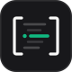

<p align="left">
  
</p>

# Tokless

[](./LICENSE)
[](./package.json)
[](./package.json)

[简体中文](./README.md) | English

**Zero-dependency token optimizer for AI coding agents (Google Antigravity, Claude Code, Codex CLI, and extensible via `targets/`).**

`tokless` cuts runaway prompt-cache snowballing without sacrificing code quality by combining sub-100ms `[Lstart-Lend]` AST-like code skeleton navigation, native `PreToolUse` blind-read brakes, MCP-stripped subagents, and 0-token local session billing/compaction audits.

In a controlled A/B bug-hunt and fix benchmark on a production Tauri + Rust + React desktop codebase, `tokless` reduced **total token throughput by 53.2% (-11.38M tokens)**, cut **cumulative Cache Read tokens by 53.8% (-11.23M tokens)**, and finished in **34.4% fewer model turns** while finding and fixing the exact same **7 deep concurrency/logic bugs** (*Note: this A/B benchmark was recorded on early `v0.1.0` with only the baseline skeletonizer and unsliced blind-read block; we have not yet re-run a full long-horizon comparison on newer releases, which add MCP-stripped lean subagents and refined line-range pass-through for even stronger theoretical savings*).

---

## Quick Install (Zero Dependencies · Node.js `>=18`)

### Option 1: One-Line CLI Setup (Recommended)

Auto-detects and installs into Google Antigravity, Claude Code (`~/.claude`), and Codex CLI (`~/.codex`). When invoked via `npx`, `tokless` automatically switches to file-copy mode so hooks never break after npm cache cleanup:

```bash
npx tokless install
```

Target specific hosts or cleanly uninstall anytime:

```bash
npx tokless install --target agy       # Google Antigravity only
npx tokless install --target claude    # Non-destructively merge into ~/.claude/settings.json + skills
npx tokless install --target codex     # Install ~/.codex/skills/code-skeleton
npx tokless install --target all       # Install across all supported hosts
npx tokless uninstall --target all     # Cleanly remove hooks/skills and restore original settings
```

### Option 2: Paste One Prompt to Your AI Agent

Drop this directly into Antigravity or Claude Code and let the agent wire itself up:

```text
Please run `npx tokless install` to enable tokless (or clone https://github.com/daoif/tokless and run `node install.js`), then verify that the read-guard hook and skills are active.
```

---

## Why `@Codebase` or `repomix` Alone Isn't Enough

A common question from heavy AI coding users: *"My IDE already has `@Codebase` semantic search, or I use `repomix`. Why does my 5-hour / weekly quota still burn out so fast?"*

- **`@Codebase` is a search engine; `tokless` is a blind-read brake.** Semantic search tells the agent *which file* looks relevant, but it does not stop the agent from lazily calling `read_file` / `Read` without line numbers and dumping a 1,500-line file straight into context.
- **`repomix` is a full-repo packer for web chat.** Packing an entire repo is great for browser chat UIs without local file tools, but inside a multi-turn CLI/IDE agent loop it front-loads tens of thousands of tokens from turn 1.
- **The Cache Read Snowball:** In multi-step agent loops, `Cumulative Cache Read ≈ Average Context Size × Model Turns`. Dumping 30K tokens of irrelevant code on step 3 across a 50-turn task charges you 47 times—over **1.4M wasted Cache Read tokens** from a single lazy read.
- **Compaction Thresholds:** Generation-3 models commonly trigger forced context compaction around **256K tokens** (`CHECKPOINT: # Resuming from a compaction`, collapsing context into a lossy summary), while Generation-4 models have been observed running past 440K without compacting (widely estimated around **512K**). Regardless of where the ceiling sits, keeping per-turn context lean and cutting redundant turns directly determines how fast your quota drains.

`tokless` works alongside `@Codebase`: once the agent knows which directory or file to inspect, `tokless` generates `[Lstart-Lend]` function/class maps in ~80ms with zero pre-indexing, and its `PreToolUse` hook blocks un-sliced reads over 200 lines (returning the file's skeleton inline so the agent immediately re-reads the exact line range).

---

## Real-World Benchmark (Tauri + Rust + React Bug Hunt & Fix)

Two isolated Git worktrees from the same commit (`3908815`), running the exact same model (`Gemini 4 Hydrogen High`) and prompt:

| Metric | Baseline (Default Agent) | With `tokless` | Delta |
| :--- | :--- | :--- | :--- |
| **Total Tokens (`input + cache_read + output`)** | 21,410,381 | **10,029,592** | **-53.2% (-11.38M)** |
| **Cumulative Cache Read Tokens** | 20,858,589 | **9,627,700** | **-53.8% (-11.23M)** |
| **Cumulative Input Tokens** | 494,886 | **352,020** | **-28.9%** |
| **Model Invocations (Turns)** | 64 | **42** | **-34.4%** |
| **Total Execution Steps** | 220 | **150** | **-31.8%** |
| **`read_file` Calls (Full Blind Reads)** | 79 (3 blind reads) | **51 (0 blind reads)** | **-35.4%** |
| **Peak Context Watermark** | 439,830 tokens | **323,344 tokens** | **-26.5%** |
| **Time to First Code Edit** | 227s (Step 115) | **196s (Step 81)** | **31s faster / -34 steps** |
| **Real Bugs Found & Fixed (Build Verified)** | 7 | **7** | **Zero quality loss** |

> **Version Note (`v0.1.0` Baseline)**: The Tauri + Rust + React A/B figures above were captured on early `v0.1.0` (which only included baseline syntax skeleton extraction and unsliced blind-read blocking) and have not yet been re-run end-to-end on the latest release. With MCP-stripped lean roles (`inheritMcp: false`) and refined line-slice pass-through introduced in subsequent versions, current theoretical end-to-end token savings are even higher. Full reports: [benchmarks/real-world-bugfix-case.md](./benchmarks/real-world-bugfix-case.md) and [benchmarks/static-skeleton-benchmark.md](./benchmarks/static-skeleton-benchmark.md).

---

## Four Core Capabilities & Platform Boundaries (v0.5.0)

`tokless` draws a transparent line between **universal capabilities that work with every AI coding tool** and **host-specific hooks or log parsers**:

| Host Agent | 1. `tokless skeleton` + `AGENTS.md` Rules | 2. `PreToolUse` Blind-Read Guard | 3. Lean Subagents (`inheritMcp: false`) | 4. `tokless audit` Inspector |
| :--- | :---: | :---: | :---: | :---: |
| **Platform Scope** | **100% Universal across all AI coding tools** | **Extensible hook (Native on Antigravity & Claude Code)** | **Antigravity Plugin Only** | **`audit project` Universal; `session / compare` Antigravity Only** |
| **Google Antigravity** | Native Skill + CLI + `rules/AGENTS.md` | Native `hooks.json` (`read_file` / `view_file`) | `tokless-coder` / `tokless-reviewer` | Full (`project` + `session` / `compare`) |
| **Claude Code** | `~/.claude/skills` + CLI | Merged `~/.claude/settings.json` (`Read`) | — | `audit project` (rules & MCP tax) |
| **Codex CLI** | `~/.codex/skills` + CLI + `AGENTS.md` | — | — | `audit project` (rules density) |
| **Other Agents** (Cursor / Windsurf / Cline / Roo Code / Trae / OpenCode, etc.) | `npm i -g tokless` + root `AGENTS.md` (Ready Today) | PRs welcome via `targets/` (see `claude-code.js`) | — | `audit project` (rules density) |

### 1. `tokless skeleton` (alias `repo-skeleton`) + `rules/AGENTS.md` — [100% Universal]

Zero pre-indexing, pure Node.js standard library. Extracts class/function signatures and exact **`[Lstart-Lend]` line ranges** across `.js/.jsx/.ts/.tsx/.vue/.svelte/.py/.go/.rs/.java/.kt/.c/.cpp/.cs/.md` in milliseconds (lazy-loading only the scanned language parser), cutting exploration tokens by **85%~97%** when paired with [`rules/AGENTS.md`](./rules/AGENTS.md):

```bash
npx tokless skeleton . --map
npx tokless skeleton ./src --depth 2
npx tokless skeleton ./src/App.tsx --json
```

### 2. `PreToolUse` Blind-Read Brake (`scripts/read-guard-hook.js`) — [Extensible Hook · Native on Antigravity & Claude Code]

Only intercepts blind full-file reads (`> 200` lines, configurable via `TOKLESS_READ_MAX_LINES`) and fake `1..EOF` slices, returning the file's `[Lstart-Lend]` skeleton inline. Once explicit line numbers are supplied, any function span—whether 50 or 500 lines—is allowed in a single read so agents never burn extra turns reading fragments.

### 3. MCP-Stripped Lean Subagents (`agents/`) — [Antigravity Plugin Only]

Ships [`tokless-coder`](./agents/tokless-coder.md) and read-only [`tokless-reviewer`](./agents/tokless-reviewer.md) with `inheritMcp: false`, stripping unused external MCP schemas to eliminate thousands of idle base tokens on every coding/review turn.

### 4. `tokless audit` (alias `agy-audit`) — [`audit project` Universal · `session / compare` Antigravity Only]

Offline 0-LLM-token inspector for rule bloat, MCP schema overhead, and Antigravity session transcripts:

```bash
# [Universal] Audit AGENTS.md / SKILL.md bloat and workspace/global MCP schema base tax
npx tokless audit project <project-dir>

# [Antigravity Only] Dissect a session's Top 5 costliest steps, Prefix Cache cliffs, and compactions
npx tokless audit session <session-id-prefix>

# [Antigravity Only] Side-by-side A/B token bill comparison between two sessions
npx tokless audit compare <before-id> <after-id>
```

---

## Where Each Target Installs & How to Use Day-to-Day

### 1. Built-in One-Command Targets (`npx tokless install`)

- **Google Antigravity** (`--target agy`):
  - **Installed to**: `~/.gemini/config/plugins/agy-tokless/` (`plugin.json`, `hooks.json`, `rules/AGENTS.md`, `skills/`, `agents/`).
  - **How it triggers**: Active automatically in new sessions—`PreToolUse` blocks blind reads on large files, `code-skeleton` guides ranged reads, `tokless-coder` / `tokless-reviewer` run without MCP tax, and `token-audit` / `npx tokless audit session <id>` inspects session bills.
- **Claude Code** (`--target claude`):
  - **Installed to**: Core runtime in `~/.claude/tokless/`, skill in `~/.claude/skills/code-skeleton/SKILL.md`, and non-destructively merged `PreToolUse` (`Read`) hook in `~/.claude/settings.json` (preserves your existing permissions and custom hooks; cleanly restored on uninstall).
  - **How it triggers**: Active automatically whenever you launch `claude`—un-sliced `Read` calls over 200 lines are intercepted with an inline `[Lstart-Lend]` map so Claude immediately re-reads the exact target lines.
- **Codex CLI** (`--target codex`):
  - **Installed to**: `~/.codex/skills/code-skeleton/` (`SKILL.md` + bundled `tools/repo-skeleton`).
  - **How it triggers**: Codex discovers the `code-skeleton` skill automatically; copy [`rules/AGENTS.md`](./rules/AGENTS.md) into your repo root `AGENTS.md` for consistent proactive triggering.

### 2. Using `tokless` with Cursor, Windsurf, Cline, Roo Code, Trae, OpenCode & Others

- **Use It Right Now (1-Minute Universal Setup)**:
  1. Install the global CLI via `npm i -g tokless` (exposes `tokless skeleton` and `tokless audit project` globally);
  2. Copy the lean-reading rules from [`rules/AGENTS.md`](./rules/AGENTS.md) into your repository's root `AGENTS.md` (or `.cursor/rules/`, `.windsurfrules`, `.clinerules`, etc.). Your agent can immediately run `tokless skeleton <path>` before reading large files, and you can run `tokless audit project .` anytime.
- **Honest Note on Native Auto-Installers & Community Co-Creation**:
  Because maintainer bandwidth is currently focused on core accuracy, we haven't hand-wired global config paths and hook formats for a dozen different editors yet. **If you use another coding agent daily, you are warmly encouraged to ask your AI to build a target adapter modeled after [`targets/claude-code.js`](./targets/claude-code.js) and open a PR—we will review and publish it promptly, and we will also add more official built-in targets over time.**

---

## Programmatic Node.js API

`tokless` exports clean CommonJS modules (`tokless`, `tokless/skeleton`, `tokless/read-guard`, `tokless/audit`) for in-process agent harnesses and custom tooling with zero child-process overhead:

```js
const {
  generateSkeleton,
  evaluateReadGuard,
  analyzeSession,
  auditProject,
} = require('tokless');

// Extract [Lstart-Lend] map for a file or directory
const skel = generateSkeleton('./src', { maxDepth: 2 });
console.log(skel.formatted);

// Evaluate Antigravity or Claude Code PreToolUse payloads in memory
const verdict = evaluateReadGuard({
  tool_name: 'Read',
  tool_input: { file_path: './src/large-module.ts' },
});
// => { decision: 'deny' | 'allow', reason?: string, host: 'claude' | 'antigravity' }
```

---

## Contributing Agent Targets & Language Parsers

### 1. Host Agent Installers (`targets/<agent>.js`)

Host integrations live as self-contained adapters under [`targets/`](./targets/):

- [`targets/antigravity.js`](./targets/antigravity.js) — Google Antigravity plugin, hooks, and lean subagents
- [`targets/claude-code.js`](./targets/claude-code.js) — Claude Code `~/.claude/settings.json` non-destructive hook merge + skill (best reference template for new adapters)
- [`targets/codex.js`](./targets/codex.js) — OpenAI Codex CLI skill installer

Rather than guessing every editor's private config layout upfront, we prioritize clean community co-creation: if you use **Cursor, Windsurf, Cline, Roo Code, Trae, OpenCode, or GitHub Copilot**, point your AI at [`targets/claude-code.js`](./targets/claude-code.js), register the new adapter in [`targets/index.js`](./targets/index.js), and open a Pull Request. Verified PRs are merged and released right away, while official support for additional hosts will continue rolling out over time.

### 2. Language Skeleton Parsers & Regression Fixes (`tools/repo-skeleton/lib/langs/<lang>/`)

Every supported language is treated on equal footing as a standalone module under [`tools/repo-skeleton/lib/langs/<lang>/index.js`](./tools/repo-skeleton/lib/langs/) backed by the shared lexer and balanced-delimiter engine in [`tools/repo-skeleton/lib/core/`](./tools/repo-skeleton/lib/core/). Each language directory manages all of its associated file extensions in one place (for example, `javascript/` handles `.js/.jsx/.mjs/.cjs/.ts/.tsx`, `c-family/` handles `.c/.h/.cpp/.hpp/.cc/.cs`, and `sfc/` handles `.vue/.svelte`), and `core/registry.js` lazy-loads a parser only when a matching file extension is actually scanned.

When fixing a real-world syntax edge case or adding a new language:

1. Update or add the corresponding `tools/repo-skeleton/lib/langs/<lang>/index.js` (and register any new extensions in `tools/repo-skeleton/lib/core/registry.js`);
2. **Add a regression test reproducing the exact real-world case in `tests/langs/<lang>.test.js`** ([`tests/run-all.js`](./tests/run-all.js) automatically discovers all `tests/**/*.test.js` suites without editing `package.json`);
3. Run the full verification suite locally (cumulative language regressions, cross-platform checks, and the zero-personal-path leak gate) to ensure 100% zero breakage before opening a PR:

```bash
npm test
```

---

## Acknowledgments

Built from scratch on the Node.js standard library. Special thanks to:

- **Contributors**: [@PXY000](https://github.com/PXY000) for cross-platform PowerShell skill templates, absolute Node binary resolution in hooks, path traversal guards, and regression tests; [@Mr-PolarBear](https://github.com/Mr-PolarBear) for Java nested classes, dotted/generic return types, anonymous field filtering, and JS top-level IIFE skeleton extraction fixes.
- **Open-Source Inspiration**: [HoangP8/tokless](https://github.com/HoangP8/tokless), [ILoveMyJay/repocontext](https://github.com/ILoveMyJay/repocontext), [pdavis68/RepoMapper](https://github.com/pdavis68/RepoMapper), and [ooples/token-optimizer-mcp](https://github.com/ooples/token-optimizer-mcp).

## License

[MIT](./LICENSE)
